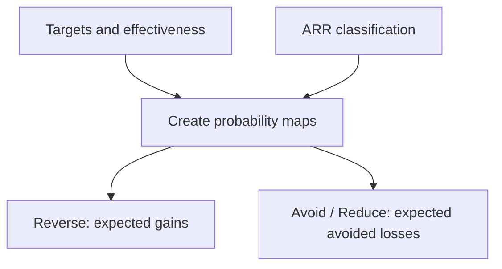

# LDN Planning — Scenario Methodology

**Scope.** This note describes the current LDN Planning methodology and its assumptions:
how interventions are spatialized, how expected gains and avoided losses are calculated, and how
scenarios are compared with a Business-As-Usual (BAU) trajectory. For the workflow and interface,
see the [feature guide](source/for_users/features/ldnplanning.rst) and
[tutorial](source/for_users/training/ldnplanning.rst).

**Conceptual basis (authoritative).**

- Cowie, A.L., et al. (2018). *Land in balance: The scientific conceptual framework for Land
  Degradation Neutrality.* Environmental Science & Policy 79: 25–35.
- UNCCD (2025). *Good Practice Guidance (GPG) Addendum for SDG Indicator 15.3.1* (Advanced Unedited
  Version).

---

## 1. Purpose and the planning question

For an overview and individual tool workflows, see the
[planning process diagrams](source/for_users/features/ldnplanning-process.md),
also published in the Read the Docs feature guide.

### Intervention ranking and reviewed candidate areas

The LDN Planning tab combines spatial decision support with scenario analysis.
Ranking expresses the planner's criteria and weights as relative preferences
within each ARR class. Candidate selection identifies areas for review, and
configured targets provide the assumptions used in a scenario.

1. Create ARR from an SDG indicator or status band; its metadata determines
   the 3-class or 7-class encoding. Optional productivity and custom risk
   inputs are aligned to the status grid, and the project area is masked.
   The risk threshold identifies values above it as at risk. Missing supplied
   risk or productivity data leave non-degraded pixels unclassified. Without
   either input, valid non-degraded land defaults to Avoid; assess local risk
   separately. The assignment-reason band records the basis for each class.
2. **Rank intervention areas** inherits the project ARR, jurisdiction choice,
   and saved land types when that breakdown is selected. Add criteria
   separately for Avoid, Reduce, and Reverse. Managed prioritization inputs
   preserve imported values, bands, and nodata, and carry optional metadata.
   A reusable scoring profile specifies a band or numeric field, a continuous
   normalization range and direction or category scores, and a resampling
   method. An advanced option accepts a file directly. The planner supplies the
   criteria and weights; weights are normalized within each configured class.
   Optional exclusion values above zero exclude pixels, and missing exclusion
   values remain unscored.
3. The result contains three relative-priority bands and three coverage bands.
   Pixels missing a required criterion and classes without criteria remain
   unscored. Compare scores within the same class and inspect coverage,
   exclusions, and alternative weights when interpreting the ranking.
4. **Select candidate areas** uses a saved ranking. For each class, select a
   minimum score or a maximum physical area. A sampled estimate supports
   setting the limits; the completed selection is deterministic, including
   ties. Area-limited selection adds whole pixels that fit the remaining cap,
   so the actual selected area can be smaller than the limit. Review the map
   and actual areas before configuring targets.
5. In **Build scenarios**, enable candidate areas and set effectiveness for
   each selected response class. Each configuration dialog initializes its
   class values from the stored default; changing the default in that dialog
   sets the default for later configurations. Accepting replaces existing
   candidate targets with the displayed class values. A mask target applies
   only to its matching ARR class. Polygon targets can also be drawn or
   imported; loading a layer snapshots live edits, and replacing that snapshot
   requires confirmation. Effectiveness is a finite fraction in [0,1];
   imported percentages require an explicit units choice. Candidate masks and
   context are checked when configuring targets and at execution, which stores
   a verified local copy.
6. A run can compare the current draft with a selected saved scenario.
   Comparisons require matching area, input checksums, bands, encodings,
   years, land types, and jurisdictions. Input paths must also match, except
   for single-file GeoJSON jurisdictions with matching checksums, including
   downloaded administrative boundaries. Results without recorded input
   checksums cannot establish unchanged source files. Differences describe
   projected effects.

The BAU comparison is a simplified aggregate that includes upper-bound
avoided-loss estimates. Assess results within each land type when considering
like-for-like neutrality. Risk-weighted avoided losses, budget optimization,
and monetary ecosystem-service valuation are possible future refinements.

The planning tab shows inline result details and map actions. Its scenario
controls open the scenario workbook; detailed output files are available in
dataset report folders. Independent hotspot and observed-counterbalancing
analyses remain available under Experimental.

Scenario analysis answers a forward-looking planning question:

> *If a set of interventions (protect / manage / restore) were implemented across chosen areas, at
> plausible levels of effectiveness, what is the anticipated contribution toward Land Degradation
> Neutrality (LDN) — and where?*

The LDN framework considers an **area-based balance of gains against losses within each land type**
(Cowie et al. 2018). Planning estimates the expected effects of proposed interventions;
retrospective monitoring assesses observed changes.

---

## 2. The response hierarchy and what each intervention can claim

Interventions are typed by the LDN response hierarchy **Avoid > Reduce > Reverse** (Cowie et al.
2018, Principle 12). The balance sheet distinguishes their contributions:

| Response | Target land condition | Mechanism | Balance‑sheet role |
|---|---|---|---|
| **Avoid** | Non-degraded, with no configured at-risk signal | Protect from anticipated future degradation | **Avoided loss** |
| **Reduce** | Non-degraded and flagged at risk | SLM slows or halts ongoing decline | **Avoided loss** |
| **Reverse** | Already degraded | Restoration / rehabilitation | **Counterbalancing gain** |

Reverse contributes expected gains in land-based natural capital; Avoid and Reduce contribute
expected avoided losses. The tool reports these separately, reflecting their different roles in
planning and counterbalancing. Their contribution to LDN depends on the baseline, other losses,
land types, and actual outcomes.

The eligible land condition for each response is taken from the **Avoid / Reduce / Reverse (ARR)
classification** layer, which reclassifies the SDG 15.3.1 status into the three response classes
under the "one‑out, all‑out" (1OAO) rule. A pixel can only receive a given intervention where its
ARR class matches (e.g. *Reverse* effects are only credited on degraded pixels).

---

## 3. Expected‑value spatialization (the core method)

### 3.1 Expected-value model

The tool treats effectiveness as an assumed **probability of successful treatment** for eligible
pixels. Reported areas are expected values derived from those probabilities.

### 3.2 Per‑pixel probability surfaces

For each polygon or candidate-mask target, the planner specifies an intervention type and an
**effectiveness** $e \in [0, 1]$. Effectiveness is rounded to a whole percentage point for the
probability raster. Where targets of the same response overlap, the pixel keeps the **maximum**
of their rounded probabilities:

$$
p(x) = \max_{\,t \,:\, x \in t \text{ and } x \text{ eligible for } t}
       \frac{\operatorname{round}(100e_t)}{100}
$$

This produces three **probability surfaces**, stored as integer percentages from 0 to 100. Each is
defined over its eligible ARR class:

- $p_{\text{reverse}}(x)$ over degraded (*Reverse*) pixels — probability of restoration success;
- $p_{\text{reduce}}(x)$ over at‑risk (*Reduce*) pixels — probability that decline is averted;
- $p_{\text{avoid}}(x)$ over *Avoid* pixels — probability that the pixel is protected.

Pixels outside a response's eligible class are marked "no data" for that surface; eligible but
untargeted pixels carry probability 0. The surfaces show where the plan is expected to act and the
assumed likelihood of success.

### 3.3 From probability to expected area

Each pixel has a physical area $a(x)$ derived from the raster grid and its coordinate reference
system. The **expected treated area** for a response is the probability-weighted sum over its
eligible class $C$:

$$
\mathbb{E}[A_{\text{response}}] = \sum_{x \in C} a(x)\, p_{\text{response}}(x)
$$

Linearity of expectation allows these contributions to be summed analytically, including when
success in different pixels is correlated. National totals are calculated from the rounded
probability surfaces, so overlaps are counted once. Individual target statistics are calculated
separately using their supplied effectiveness; overlapping targets can contribute to more than one
such statistic, and rounding can also make their sum differ from the national total.

The three response totals map onto the balance sheet per §2:

$$
\text{gains} = \mathbb{E}[A_{\text{reverse}}], \qquad
\text{avoided losses} = \mathbb{E}[A_{\text{reduce}}] + \mathbb{E}[A_{\text{avoid}}]
$$

### 3.4 Interpreting the numbers

- The expected areas are **planning estimates** that answer "on average, how much area would this
  plan be expected to restore / protect?" Actual outcomes depend on implementation and local
  conditions.
- A non-overlapping target's contribution follows its rounded probability. For overlapping targets,
  changing one target has an effect only where it changes the maximum assigned probability.
- Effectiveness values are exposed as visible, documented, editable inputs so that every number on
  the balance sheet is traceable to a stated assumption.

---

## 4. Accounting dimensions: land type and jurisdiction

Neutrality must be judged **"like for like" within land types** defined by land potential, mapped at
the baseline and held fixed. Gains and losses are evaluated within each land type. The tool can
group the expected-area contributions of §3.3 along two dimensions:

1. **By land type** — choose a saved land-types layer or a land-cover dataset as a proxy where
   appropriate. A new project starts with no land-type breakdown; selecting saved land types or land
   cover enables the corresponding breakdown. A saved layer can combine several categorical
   rasters to represent land potential.
2. **By jurisdiction** — choose first-level administrative units for the selected country or a
   polygon file. This groups results by geographic areas relevant to implementation.

The workbook reports available group-level expected gains and avoided losses in separate sheets.
National totals are calculated over the assessed area. Group rows reflect the pixels covered by
their aligned grouping layer, so check coverage and boundaries before reconciling them with the
national totals. With no land-type breakdown, the scenario sheet uses a single synthetic group
named `Land type 1`; this group does not represent a mapped land-potential class, and there is no
per-land-type BAU breakdown.

**Defining land types.** The *Define Land Types* tool combines one or more categorical rasters
(such as land cover, land potential, or soil classes) into a raster where each unique combination
of input class values is a land type. The saved layer can be reused in scenario breakdowns and
Counterbalancing. Check the aligned grid and study-area coverage when using the same definitions
across analyses.

**Defining jurisdictions.** First-level administrative units are fetched for the selected country;
a polygon file provides an alternative. Jurisdictions and land types can both be included in the
same run. Review their coverage, boundaries, and resulting group names when interpreting subtotals.

---

## 5. Comparison against BAU over the planning horizon

The tool evaluates each scenario against a **Business-As-Usual (BAU)** projection over a
user-specified horizon ($t_0 \to$ target year):

- The BAU trajectory uses the degraded area of the reporting band, or of the baseline band when no
  reporting band is selected. Degraded classes are cumulative over the band's metadata period
  ($t_s \to t_e$; for status bands, baseline start to reporting end), so the annual rate is
  $r = D/(t_e - t_s)$ and $D_{\text{BAU}}(t) = D + r\,(t - t_e)$. The LDN frame of reference sets
  the **target = baseline** degraded area — no net loss; Cowie et al. 2018, Module B. When usable
  period metadata is missing, the planner supplies the period. The projection is an unconstrained
  linear extrapolation and can exceed the assessed area, particularly over long horizons.
- The scenario's **gains** (Reverse) and **avoided losses** (Avoid + Reduce) are subtracted from the
  BAU‑projected degraded area to give a **scenario‑adjusted degraded area** at the target year:

$$
D_{\text{scenario}}(t) = \max\!\big(0,\; D_{\text{BAU}}(t) - \text{gains} - \text{avoided losses}\big)
$$

- The result includes a **simplified aggregate indicator** of whether
  $D_{\text{scenario}}(t) \le D_{\text{baseline}}$. It also reports the BAU shortfall above the
  baseline, the share of that shortfall closed, and the remaining shortfall, with corresponding
  jurisdiction summaries where available. A zero BAU shortfall is reported as 100% closed.
  Evaluate like-for-like neutrality separately for each land type: when a breakdown is configured,
  the BAU and scenario land-type sheets provide separate information for that review. The
  aggregate indicator alone does not establish like-for-like neutrality.

---

## 6. Assumptions and limitations (current phase)

The method is deliberately transparent about where it simplifies:

1. **Avoided losses are an upper bound.** *Avoid* and *Reduce* credit is computed as the expected
   treated area of eligible non-degraded land. This assumes that all of that area would otherwise
   degrade under BAU. Actual avoided losses depend on future risk and intervention outcomes;
   interpret these figures as an optimistic ceiling.
2. **Effectiveness is a single scalar per target.** A flat probability is applied uniformly across a
   target and rounded to whole percentage points, without automatic adjustment for biophysical
   suitability, accessibility, or cost.
3. **Analytic expectation and uncertainty.** The expected areas summarize the assumed probabilities;
   the tool does not calculate an uncertainty distribution or confidence intervals.
4. **Land-type choice.** A land-cover dataset can serve as a proxy for land potential where
   appropriate. The default is no breakdown until land types are selected; the choice and quality
   of grouping data affect a like-for-like assessment.
5. **Grouping‑layer alignment.** Land‑type and jurisdiction layers are resampled/rasterized onto the
   ARR analysis grid; coarse, incomplete, or misaligned inputs affect group boundaries and coverage.

---

## 7. Possible methodological refinements

Potential future work includes weighting avoided losses by an explicit BAU degradation-risk
surface, incorporating spatially varying intervention suitability, and modeling uncertainty with
an ensemble of outcomes. These refinements would require additional assumptions and validation.

---

## 8. Relationship to counterbalancing (neutrality check)

The scenario balance sheet estimates future intervention effects. The LDN **Counterbalancing**
module assesses observed gains and losses from a status layer. Reverse effects enter the projected
"gains" side; Avoid/Reduce enter "avoided losses" as upper bounds. A like-for-like determination
requires assessing gains and losses within every eligible land type. The simplified aggregate BAU
comparison provides a starting point for that review.

Both analyses can use a saved land-types layer from *Define Land Types*. Reusing consistent land
types, reference periods, and spatial coverage supports comparisons between the scenario summaries
and the observed counterbalancing assessment.

---

## 9. References

- Cowie, A.L., Orr, B.J., Castillo Sanchez, V.M., Chasek, P., Crossman, N.D., Erlewein, A., Louwagie,
  G., Maron, M., Metternicht, G.I., Minelli, S., Tengberg, A.E., Walter, S., Welton, S. (2018).
  *Land in balance: The scientific conceptual framework for Land Degradation Neutrality.*
  Environmental Science & Policy 79: 25–35.
- UNCCD (2025). *Good Practice Guidance Addendum for SDG Indicator 15.3.1* (Advanced Unedited
  Version).
- Sims, N.C., et al. *Good Practice Guidance: SDG Indicator 15.3.1, Proportion of Land That Is
  Degraded Over Total Land Area* (UNCCD), for the underlying status/one‑out‑all‑out accounting.
