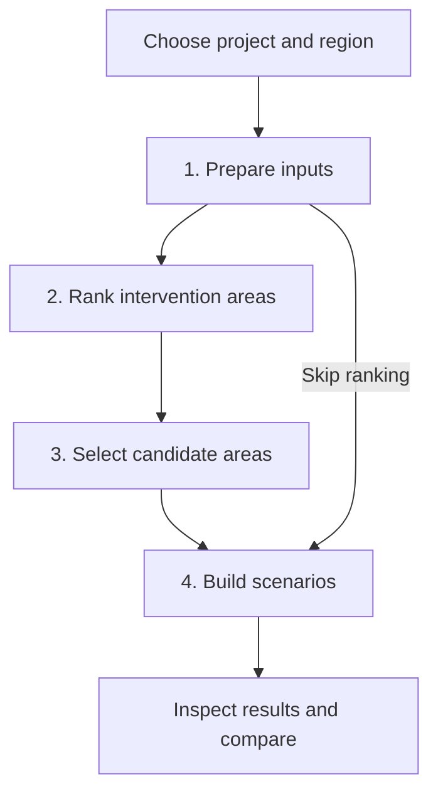
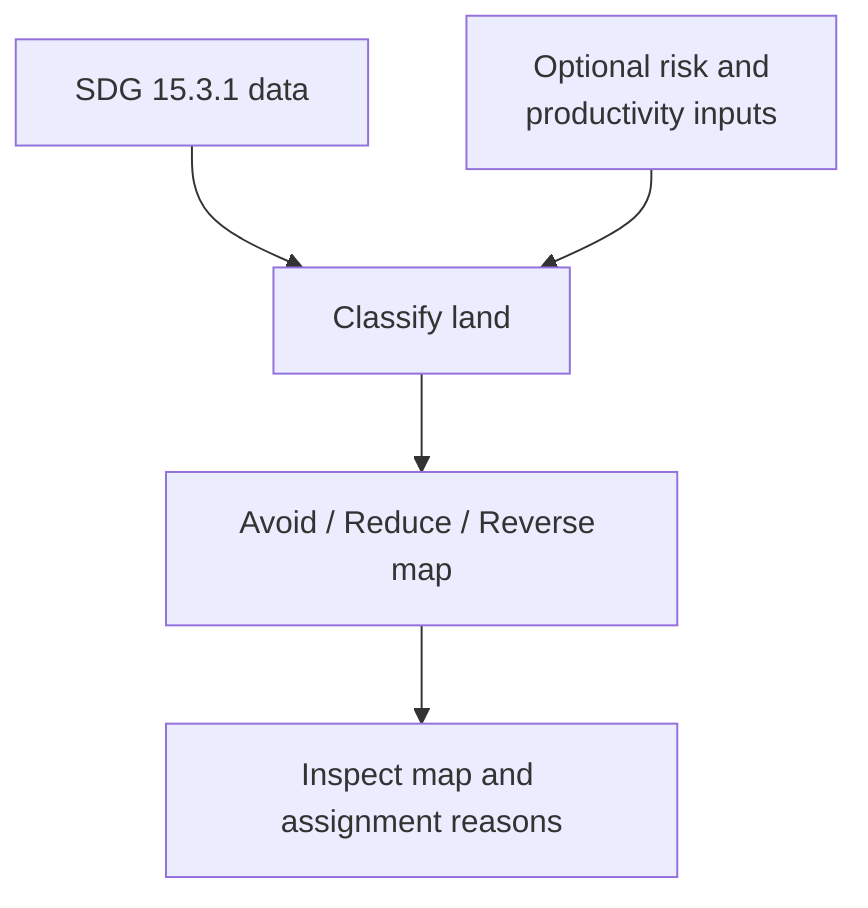
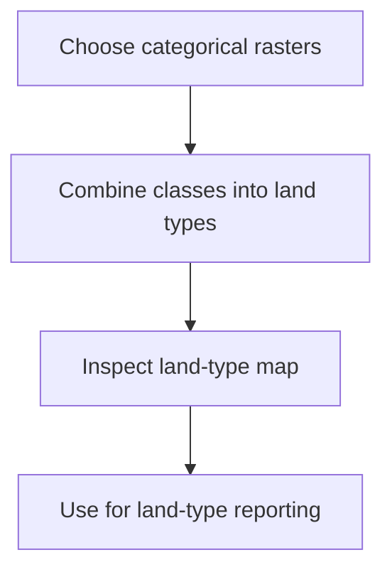
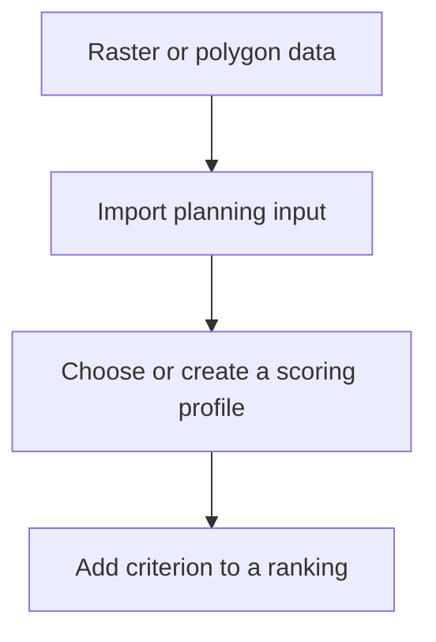
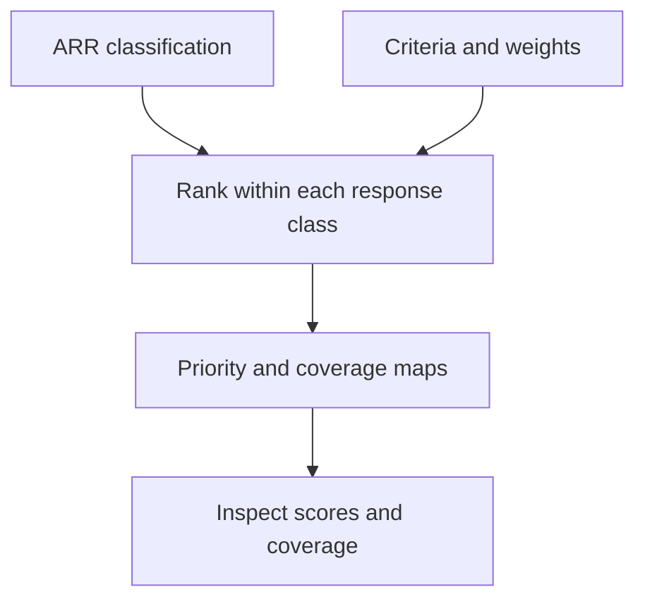
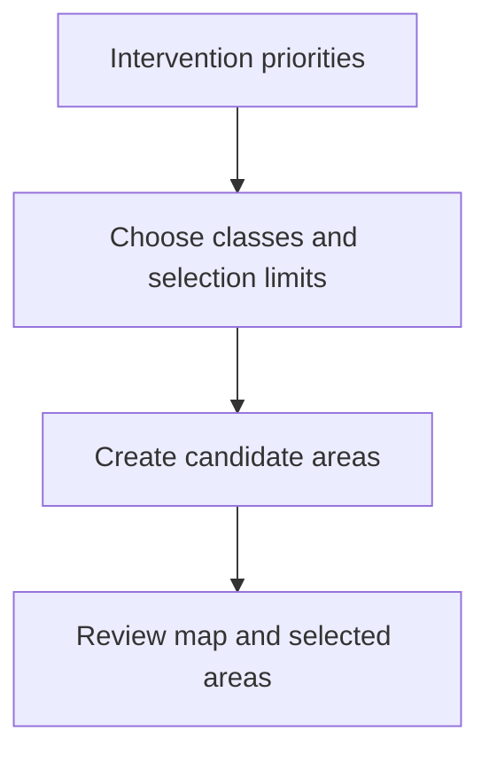
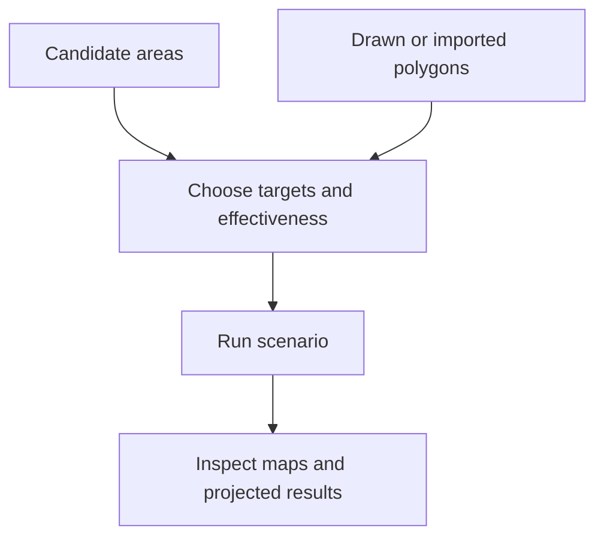
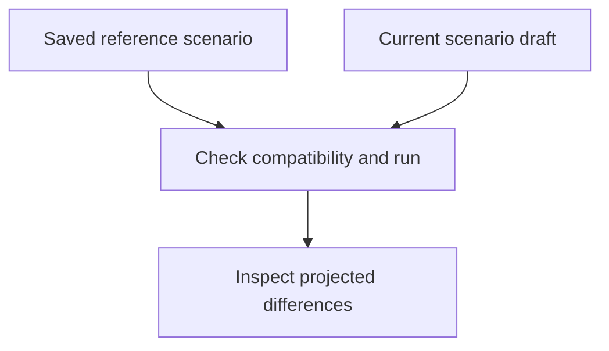
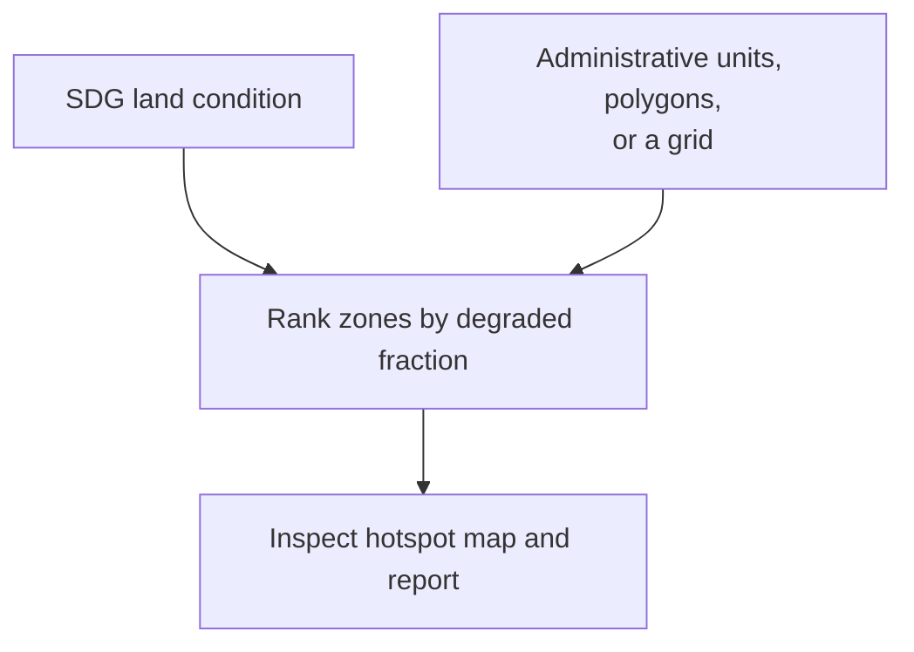
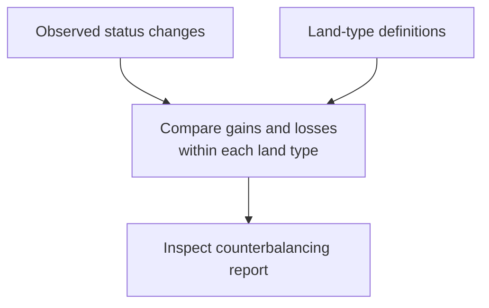

(ldn_planning_process)=

# LDN Planning process diagrams

These diagrams explain the planning tools' inputs, decisions, and outputs.
For operating instructions, see the [planning tutorial](../training/ldnplanning.rst);
for interpretation, see the [feature guide](ldnplanning.rst).

## Overview: from project inputs to scenarios

The four panel sections describe a flexible planning journey. Ranking and
candidate selection are optional: a scenario can use drawn or imported
polygons. A scenario needs ARR, a baseline indicator, and a target year; land
types, reporting-period data, and jurisdictions are optional.

Configure candidate targets explicitly after selecting a candidate dataset.
Revisions create new results and preserve earlier analyses. Scenarios can use
candidates, polygons, or both. Leaving both target sources unchecked runs a
zero-intervention scenario after confirmation.

## Prepare inputs: classify Avoid / Reduce / Reverse

ARR identifies where each response is eligible. The status band's metadata
determines its encoding. Optional risk and productivity inputs inform the
classification; the assignment-reason band records the basis for each assignment.

Without risk or productivity inputs, valid non-degraded land defaults to Avoid.
Assess local risk separately when using this default. Missing supplied risk or
productivity data leave non-degraded pixels unclassified.

## Prepare inputs: define land types

Land types group land with similar potential for reporting and like-for-like
accounting. This is an optional preparation tool, independent of ranking.

Land types can be used in ranking and scenario breakdowns or observed
counterbalancing. Keep their definitions consistent when comparing scenarios.
Assess gains and losses separately within each land type.

## Prepare ranking criteria: import inputs and save scoring profiles

Importing a dataset preserves its values; a scoring profile separately defines
how those values express a planning preference. Profiles are reusable revisions.

Profiles describe preferences for continuous values or scores for categories.
No criteria or value judgments are added by default. Values outside a continuous
profile's declared range are clamped; unconfigured categories remain unscored.

## Rank intervention areas

Ranking uses the selected ARR classification to determine class eligibility.
It combines the planner's criteria **within each response class**, without
changing ARR classes.

Classes without criteria and pixels missing required inputs remain unscored.
Exclusions can be supplied. Compare scores within the same ARR class and
review the criteria and weights when comparing different runs. Changing the
project's ARR input requires reviewing or revising earlier rankings.

## Select candidate areas

Selection turns a ranking into a proposed intervention mask. Sampled estimates
help choose settings; the completed calculation supplies actual selected areas.

For each class, choose a minimum score or maximum area. Area-limited selection
resolves ties deterministically and adds whole pixels that fit within the
specified limit. Review and configure the resulting candidates as targets in a
scenario draft.

## Build scenarios: target sources and execution

Choose candidate areas, drawn or imported polygons, or both. A scenario also
needs the project's ARR classification, a baseline indicator, and a projection
year. Disabled target sources retain their settings for later use.

Effectiveness represents an assumed fraction of intervention success. Targets
apply only to matching ARR classes; overlapping targets of the same response
use the highest effectiveness. Loading polygons takes a snapshot of live QGIS
edits while leaving them uncommitted, and replacing a snapshot requires
confirmation. Candidate settings must match the selected mask and project
inputs before execution. A run with neither target source enabled produces a
zero-intervention scenario after confirmation.

Results distinguish expected restoration gains from expected avoided losses
and include a business-as-usual (BAU) projection. Avoided losses are upper-bound
estimates, and the aggregate comparison needs land-type review for
like-for-like assessment. Open the workbook from the saved scenario's controls.

## Compare scenario alternatives

A comparison runs the **current draft** against a saved reference and preserves
previously completed results.

Comparisons require matching area, input paths and checksums, years, and
breakdowns. Older results without recorded checksums cannot establish unchanged
source files. Differences describe projected effects.

## Independent tool: degradation hotspots

Hotspots rank geographic zones by observed degradation fraction. This independent
analysis can complement ARR-based intervention ranking and scenarios.

The hotspot analysis uses the status raster extent and the supplied zones,
without an additional current-region mask. Prepare those inputs for the intended
analysis area. Rank 1 has the highest degraded fraction.

## Independent tool: observed counterbalancing

Observed counterbalancing uses measured status changes. Scenario results
provide a separate view of projected intervention benefits.

Assess gains and losses within each land type. Scenario expected gains and
avoided losses describe possible future effects.
